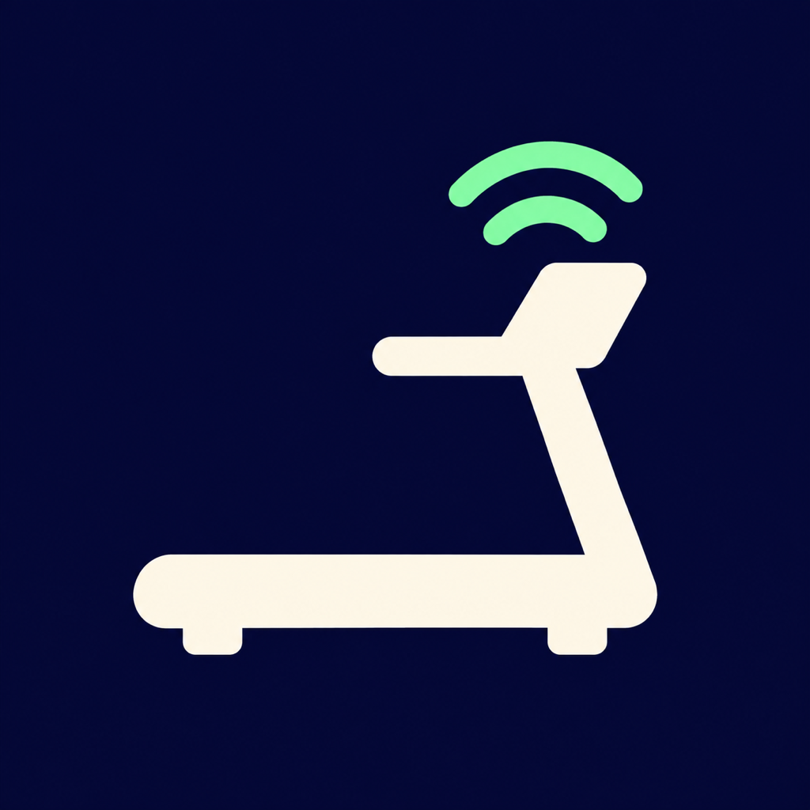
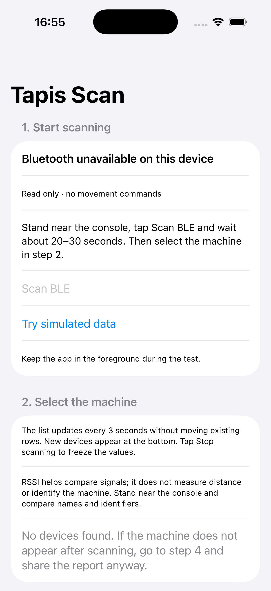
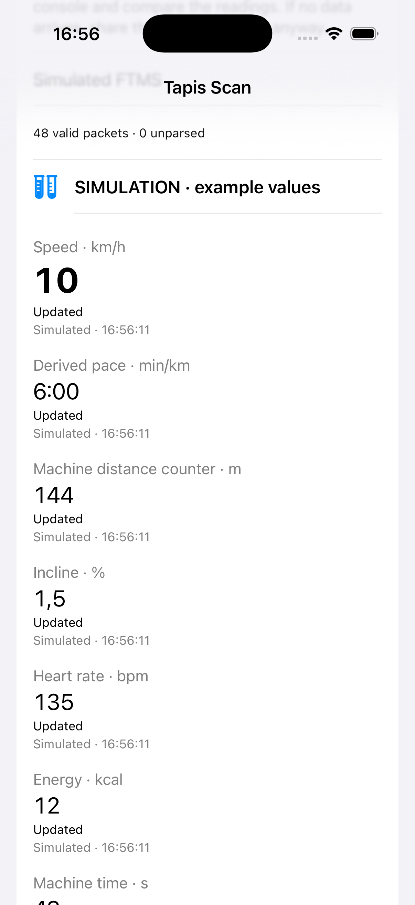

# Tapis Scan



An iPhone app built with SwiftUI to discover a treadmill's Bluetooth Low Energy interfaces and inspect available FTMS telemetry. Check compatibility without sending movement commands.

**Experimental:** installation on iPhone and simulated telemetry have been verified. Compatibility with real treadmills has not yet been verified. The interface is in English.

## Screenshots

Actual captures from the running iOS Simulator. Bluetooth scanning requires a physical iPhone; the telemetry shown below is explicitly simulated and is not evidence of treadmill compatibility.

| Scanning instructions | Simulated live telemetry |
| --- | --- |
|  |  |

## Features

- Discover BLE devices with advertised names, local identifiers, RSSI and last-seen times.
- Refresh the list every 3 seconds. Sort the initial batch by signal strength, then keep existing rows in place. Append new devices, sorted within each new batch.
- Show two devices initially, with the rest in an expandable list. Connecting always requires explicit selection.
- Keep collecting advertising and RSSI for the report without slowing telemetry notifications. **Stop scanning** applies the latest discoveries and freezes the list; a new scan starts from scratch.
- Enumerate GATT services and characteristics, including numeric property flags.
- Subscribe to FTMS Treadmill Data notifications (`1826/2ACD`).
- Display speed, cumulative machine distance, incline, heart rate, energy, machine time, power and average speed when received. Calculate pace separately from speed.
- Mark metrics as never received, stale after 5 seconds, or last known values after disconnection.
- Save and share a text report containing timestamps, advertising, raw notifications and parsed readings.
- Try simulated data through the same parser without hardware.

An RSSI of −50 dBm is stronger than −80 dBm: **it is not a distance measurement or proof of device identity**. Core Bluetooth identifiers are local identifiers, not MAC addresses.

## Installation

You need a Mac with Xcode, an iPhone running iOS 16 or later, and your own Apple account for signing. The SwiftPM core requires Swift 6. The project has been built with Xcode 26.6 and the iOS 26.5 SDK; the app has been installed and opened on an iPhone 12 running iOS 26.5.2. The declared minimum OS versions have not been tested on hardware.

```sh
git clone https://github.com/chrimatte/tapis-diagnostics.git
cd tapis-diagnostics
open Tapis.xcodeproj
```

1. Select the **Tapis** scheme.
2. In **Signing & Capabilities**, select your Team and choose a unique Bundle Identifier if needed.
3. Connect your iPhone, trust the Mac, and enable Developer Mode if prompted by iOS.
4. Select the iPhone as the run destination and press **Run**. Trust your developer profile and allow Bluetooth access if prompted.

No certificates or signing Team are included. The simulator supports the UI and simulated telemetry, not real BLE scanning. There is no App Store or TestFlight distribution.

## First test

The app guides you through four numbered steps: scan, select, check data, and share a report.

1. Near the console, tap **Scan BLE** and compare names, identifiers and RSSI. Avoid connecting at random if you cannot identify the machine.
2. Tap a device: scanning stops and the app attempts to connect.
3. Keep the app in the foreground. Watch for FTMS packets; some data may only appear while the machine is in use. If your gym permits it, start the treadmill from its console and compare the readings. The app does not start or stop the belt.
4. Tap **Prepare updated report**, then **Share prepared report**. Sharing uses a snapshot of the data collected up to preparation time. Review identifiers before sharing publicly.

To try the app without hardware, tap **Try simulated data**. Example readings are explicitly labelled; **Disconnect** also stops the simulation. If the machine does not appear or sends no data, you can still share the diagnostic report.

## Limitations and privacy

- Bluetooth audio pairing does not prove BLE telemetry is available. If the machine does not appear, check its model, pairing mode and Bluetooth type.
- Only FTMS Treadmill Data is parsed; not every field is displayed. Proprietary services are listed but are not automatically subscribed to or decoded. Technogym/MyRun compatibility is not claimed.
- Speed is machine-reported and may be nominal or a setpoint. Distance and time are machine counters, not totals for a session recorded by the app. “Never received” does not mean “unsupported”.
- Leaving the foreground disconnects the diagnostic session. It does not resume automatically. Remote control, structured workouts, activity recording and FIT export are outside this diagnostic app's scope.
- No backend or automatic uploads. Reports include identifiers and advertising from nearby devices: review and anonymize them before sharing or attaching them to public issues.
- Each app launch creates a report in the app's Documents folder, accessible through Files/Finder. Each report is limited to 10 MB, with an in-app warning when full. Previous reports are not automatically deleted. The preview shows only recent lines; manually remove reports you no longer need.
- Device names and operating-system error messages come from external sources and may use other languages. Existing reports are preserved in their original language.

## Development and verification

```sh
swift test
xcodebuild -project Tapis.xcodeproj -scheme Tapis -sdk iphonesimulator \
  -configuration Debug -derivedDataPath DerivedData CODE_SIGNING_ALLOWED=NO build
```

The 12 XCTest cases cover parsing, optional fields, truncated/malformed packets, signed values, stale readings, zero-speed pace, unavailable RSSI, journaling, stable device ordering, coalescing repeated discoveries and resetting the list. Simulator and signed iPhone builds have been verified locally. This is not FTMS compliance or accessibility certification.

`Sources/TapisCore` contains parsers and models; `iOS` contains BLE transport, simulation and UI; `Tests` contains synthetic fixtures. `project.yml` can regenerate the project with `xcodegen generate`; XcodeGen is not required to open the included project. There are no third-party runtime package dependencies.

See [CONTRIBUTING.md](CONTRIBUTING.md) for conventions, checks and screenshot reproduction. Existing Git history is preserved; earlier commits may contain Italian text.

## Contributors

- [chrimatte](https://github.com/chrimatte) — project creator and maintainer; product direction and on-device validation.
- **OpenAI Codex** — AI-assisted implementation, tests, documentation, and development tooling, guided by the maintainer.

Codex is credited here as an AI development tool, not as a human maintainer.

## License and references

[MIT](LICENSE). The app icon was created using AI image generation for this project. No qdomyos-zwift adapter code or Garmin SDK code is included. This project is not affiliated with fitness equipment manufacturers.

- [Apple Core Bluetooth](https://developer.apple.com/documentation/corebluetooth)
- [Bluetooth SIG Assigned Numbers](https://www.bluetooth.com/specifications/assigned-numbers/)
- [Bluetooth SIG Treadmill Data XML, published copy](https://raw.githubusercontent.com/oesmith/gatt-xml/master/org.bluetooth.characteristic.treadmill_data.xml), consulted as a format reference, not included in the project.
